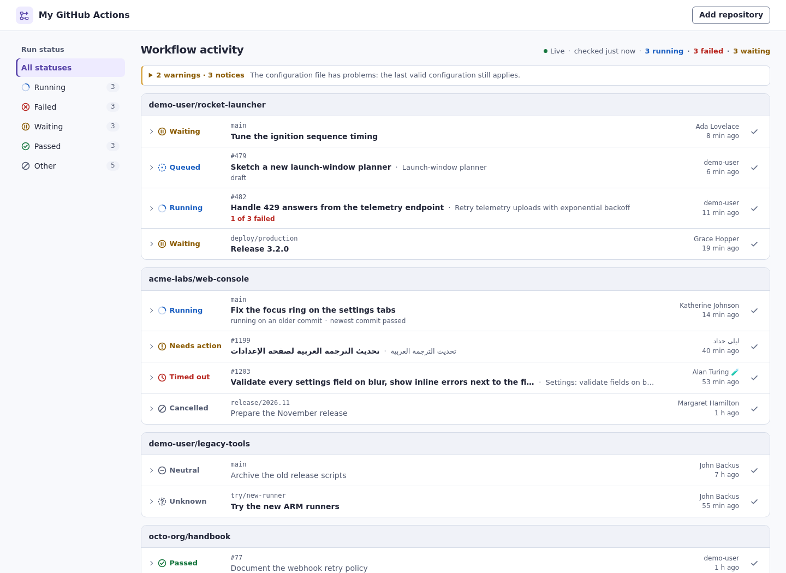
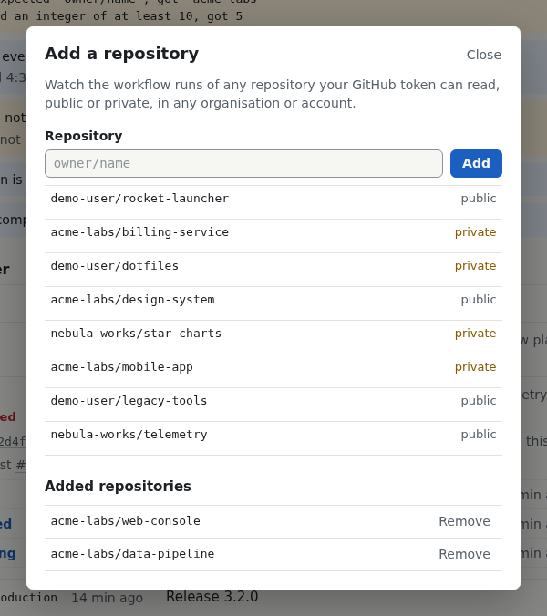

# github-action-viewer

A small local web page that shows, in real time, the GitHub Actions runs I care about:

- runs linked to my open pull requests (in any repository),
- runs in my own repositories,
- runs in any other repository I add, public or private, of any organisation or account.

One section per repository, one line per branch or pull request: state, ref, date, commit title
and author. It updates by itself, and the tab title and icon say whether something is running or
failed, so a pinned tab is enough.



<sup>Demo mode (`pnpm demo`): every name on it is made up.</sup>

## Quick start

```sh
pnpm install
pnpm start                 # then open http://127.0.0.1:4680/
```

That is all if the [GitHub CLI](https://cli.github.com/) is logged in (`gh auth login`); otherwise
set `GITHUB_TOKEN` (see [Token](#token)). Without a configuration file the page shows your own
repositories pushed to in the last 30 days and every repository where you have an open pull
request; add others with the page's [**Add repository**](#adding-repositories) button.

```sh
pnpm start --port 4700 --config ~/my-viewer.json
pnpm start --help
pnpm demo                  # made-up data, no token needed (see Demo mode)
```

`pnpm start` compiles the page into `dist/web/`, then runs the server's TypeScript sources
directly with Node 26 (no build step for the server). The server prints one line with its URL. It
then logs a line per collection when something changes (at most one a minute while runs progress,
one every ten minutes otherwise): repositories shown, requests sent and how many were free `304`s,
the remaining quota and the next poll. Stop it with Ctrl+C.

## Reading the page

**Under the heading**, the status line says whether the page is connected (_Live_,
_Reconnecting…_, _Disconnected_), when GitHub was last checked, and what is going on: how many
lines are running, failed (the newest commit has a failed or timed-out run) or waiting for
someone (running and waiting also count runs still going on an older commit). Notices follow when something deserves attention: data that could not be refreshed (with
the reason and since when), problems in `config.json` (the exact messages; the last valid
configuration keeps applying), polling slowed down to save the API quota or held by a rate limit,
and repositories that could not be read.

**Each line** reads `[state] ref date commit title … author`:

| State              | Meaning                                                                       |
| ------------------ | ----------------------------------------------------------------------------- |
| Running, Queued    | A run is in progress, or accepted but not started.                            |
| Waiting            | Paused on an environment protection rule (e.g. a required reviewer).          |
| Needs action       | GitHub needs someone to act, e.g. approve a first-time contributor.           |
| Failed, Timed out  | A run failed (also when the workflow file is invalid) or timed out.           |
| Cancelled, Skipped | The run was cancelled, or its jobs were skipped.                              |
| Passed, Neutral    | The runs succeeded, or ended neutral.                                         |
| Stale, Unknown     | GitHub gave up on an incomplete run, or sent a state this tool does not know. |

Every state has its own icon shape as well as its colour. A line takes the most urgent state of its
runs: anything running wins, so a line reads _Running_ even while only a run of an **older**
commit is still going; a note under the line then says so ("running on an older commit · newest
commit passed"), and failures among several runs show as "1 of 3 failed". The ref links to the
pull request or to the branch's runs; for a pull request, its title follows the commit title in
grey. Click the state (or press Enter on it) to list the line's workflow runs with their event,
number, attempt and time, each linking to its run on GitHub; hover any date for the exact time.

The **Run status** filters (_Running_, _Failed_, _Waiting_, _Passed_, _Other_) each show how many
lines have that status. Press one or more to show matching lines, and **All statuses** to clear the
status filters. A line running on an older commit while its newest commit failed counts as both
_Running_ and _Failed_. _Passed_ counts lines whose newest commit passed. _Other_ gathers the
remaining lines (cancelled, skipped, neutral, stale, unknown). The choice is kept in the page's address (`?status=failed,waiting`), so a
reload or a bookmark keeps it; the summary, tab title and icon still describe every line (except
those marked as done).

The check mark at the end of a line marks it as **done** and hides it, like _Mark as done_ on
GitHub's notifications. The line comes back by itself after a new commit, a new or re-run
workflow (also on an older commit), or its newest commit's verdict changing (a running commit
that finishes). Lines marked as done no longer count in the summary or the tab title and icon. The
**Include done** filter shows how many there are. Pressing it puts them back among the
other lines, shaded, where the status chips count and filter them like any other line, and their
check mark takes them back. The marks are kept in the browser (its local storage): they survive a
reload and apply to every tab of that browser, but not to another browser or device.

Expand the notice summary above the activity list to see all collection and configuration details.
A repository the server could not refresh keeps its earlier lines with "May be out of date" in
its header. The tab title repeats the summary, e.g. "2 running · 1 failed · My GitHub
Actions", and the tab icon is green (all quiet), blue (running or waiting), red (failed) or grey
(disconnected).

## Adding repositories

**Add repository**, next to the status line, watches one more repository: any repository the token
can read, public or private, whoever owns it (another organisation, another account).



- Below the field are the repositories GitHub lists for you: the ones you own, collaborate on or
  reach through an organisation, most recently pushed first, without the archived ones. Typing
  narrows the list; click a repository, or reach it with the arrow keys, to add it.
- Any other repository, such as someone else's public one, is added by its full name: type
  `owner/name` (or paste its GitHub address) and press Enter. The server checks with GitHub that
  the token can read it, and says so if it cannot.
- **Added repositories** lists what was added so far, each with a **Remove** button.

A repository that is added shows its default branch and your open pull requests, and its other
branches and pull requests while their runs are active (see [Configuration](#configuration)). It
only appears on the page once it has a workflow run to show.

Adding and removing edit `maintainedRepositories` in [`config.json`](#configuration), which is
created if there is none; editing that key by hand does the same. The file is rewritten as
indented JSON, keeping its other keys and their order. Adding a repository listed in
`excludedRepositories` also takes it off that list. While the file has problems the dialog changes
nothing: fix the file first. Start the server with `--read-only` to remove the button and never
have the file written.

If a private repository of an organisation is neither offered nor found, the token cannot read it
(see [Token](#token)).

## Configuration

The viewer reads a `config.json` file. Every key is optional; [`config.example.json`](config.example.json)
lists them all with their defaults. Unknown keys are rejected (they are usually typos), and every
problem is reported at once with the key at fault. Repository names are written `owner/name` and
compared case-insensitively.

| Key                               | Default | Meaning                                                                                                                           |
| --------------------------------- | ------- | --------------------------------------------------------------------------------------------------------------------------------- |
| `maintainedRepositories`          | `[]`    | Repositories to watch in addition to your own, e.g. `["example-org/example-service"]`; the page's **Add repository** edits it.    |
| `excludedRepositories`            | `[]`    | Repositories never shown, even if you own them, maintain them or have a pull request there.                                       |
| `includeOwnRepositories`          | `true`  | Watch the repositories you own.                                                                                                   |
| `ownRepositoriesPushedWithinDays` | `30`    | Only watch your own repositories pushed to within this many days (an integer ≥ 1), to skip dormant ones; `null` watches them all. |
| `includeMyPullRequests`           | `true`  | Watch every repository where you have an open pull request, showing only your pull requests there.                                |
| `recentWindowHours`               | `24`    | How long finished runs of other branches and other people's pull requests stay on the page (a number ≥ 0).                        |
| `pollIntervalSeconds`             | `15`    | Time between two refreshes from GitHub, in whole seconds, from 10 to 3600.                                                        |
| `port`                            | `4680`  | Port of the local server (bound to `127.0.0.1`).                                                                                  |

In a repository you own or maintain, the page always shows the default branch and your open pull
requests; other branches and other people's pull requests appear while their runs are active and
for `recentWindowHours` after they finish.

The file is `config.json` at the repository root, or the path given by `--config` or the
`GITHUB_ACTION_VIEWER_CONFIG` environment variable. Edits apply **without a restart**: the server
re-reads the file every second, applies a change once two reads in a row agree (within about two
seconds of saving), and collects again at once. It follows symbolic links (e.g. a file kept in a
dotfiles repository), and the file and its directory may be created after the server started.

- No file: the defaults apply, and the log says where to create one.
- An invalid file (not JSON, or a wrong value) is ignored: the server keeps the last valid
  configuration (the defaults if there never was one) and the page shows what is wrong.
- A new `port` only applies after a restart; the log says so.

## Polling and the API quota

The server collects at the configured interval, never two collections at once. An unchanged
collection costs nothing (GitHub answers `304 Not Modified`), but each repository with a running
workflow costs about one request per poll. Opening the **Add repository** dialog lists your
repositories (one request per hundred, free again while the list has not changed, and at most
once a minute), and adding one costs one more request. When the latest collection's cost, repeated until the
quota resets, would leave less than 20 % of the hourly quota for your other tools, the interval is
stretched to fit (and shrinks back when activity drops). After a rate limit, nothing is sent until
GitHub allows it.

Nothing disappears from the page for lack of data. A repository the latest collection could not
read completely (rate limit, network or server error, incomplete search) keeps its previous state,
marked stale; one that is no longer watched is only removed once the lists it came from (your
repositories, your pull requests) were read completely. When a whole collection fails (network
down, token rejected), the page keeps the last good data, marked stale with the reason, and the
server retries with a growing delay (up to 5 minutes) until it works again.

## HTTP API

The server listens on `127.0.0.1` only. All responses are same-origin; there is no CORS.

| Route               | Response                                                                                       |
| ------------------- | ---------------------------------------------------------------------------------------------- |
| `GET /api/snapshot` | The current payload as JSON (`Cache-Control: no-store`).                                       |
| `GET /api/events`   | A [Server-Sent Events](https://html.spec.whatwg.org/multipage/server-sent-events.html) stream. |
| `GET /…`            | The page's static files, from `dist/web/` (`/` is `index.html`).                               |

and, unless the server runs with `--read-only`, the routes behind the page's
[**Add repository**](#adding-repositories) dialog:

| Route                                                | Response                                                                      |
| ---------------------------------------------------- | ----------------------------------------------------------------------------- |
| `GET /api/repositories`                              | A `RepositoryCatalogue`: the repositories GitHub lists for you, to offer.     |
| `PUT /api/maintained-repositories/{owner}/{name}`    | Adds the repository to `maintainedRepositories`; answers a `WatchListChange`. |
| `DELETE /api/maintained-repositories/{owner}/{name}` | Removes it; answers a `WatchListChange`.                                      |

`PUT` and `DELETE` take no body, do nothing when there is nothing to do (`changed: false`), and
need an `Origin` header naming the server itself, which a browser adds on its own:

```sh
curl -X PUT -H 'Origin: http://127.0.0.1:4680' \
  http://127.0.0.1:4680/api/maintained-repositories/example-org/example-service
```

Their errors are JSON, `{ "error": "…" }`, with a message for the reader: `400` for something
that is not an `owner/name`, `404` for a repository GitHub does not find or the token cannot
read, `403` when GitHub denies access (the message says why), `409` while the configuration file
has problems, `429` during a GitHub rate limit, `502` or `504` when GitHub fails or cannot be
reached, `500` when the file cannot be written.

The payload is a `PagePayload` ([`src/server/payload.ts`](src/server/payload.ts), types only, so
the page can import it with `import type`): the core `Snapshot` (null until the first successful
collection) and a `status` with when data was last checked and last collected successfully,
whether it is stale and why, the repositories shown from earlier data, the poll interval (base and
current, and why they differ), the API quotas, and the state of the configuration file (with the
maintained repositories, and whether the page may edit them).

The event stream sends:

- `event: payload`, with a `PagePayload`, on connection and whenever the content changes;
- `event: heartbeat`, with a `Heartbeat` (server time, last check, next poll, interval, quotas),
  after each collection that changed nothing and every 15 seconds. Timestamps and quotas change on
  every collection, so they are not counted as changes; a page that hears nothing for much longer
  than 15 seconds can treat the connection as dead (`EventSource` reconnects by itself).

At most 16 streams are open at once; more get `503`. Other methods than `GET` and `HEAD` get
`405` (other than `PUT` and `DELETE` on a maintained repository), unknown paths `404`, and the
error bodies of these routes are a generic word or two.

### Behind a reverse proxy

To reach the viewer from other devices, put a reverse proxy in front of it and name the host the
browser will use with `--allowed-host` (repeatable; `name:port` unless the proxy is on the
default port). With [Tailscale](https://tailscale.com/kb/1312/serve):

```sh
pnpm start --allowed-host my-machine.my-tailnet.ts.net:4680
tailscale serve --bg --https 4680 http://127.0.0.1:4680
```

Whoever can open the page through the proxy can also add and remove repositories; add
`--read-only` if they should only look.

### Security

The process holds a token that may have write scopes, and any web page open in the browser can
send requests to `127.0.0.1`. So the server:

- listens on the loopback interface only, so other machines cannot reach it;
- refuses (`403`) any `Host` other than `127.0.0.1:<port>`, `localhost:<port>` or one given with
  `--allowed-host`, which defeats DNS rebinding (a hostile domain re-pointed to 127.0.0.1 still
  sends its own name);
- sends no CORS headers, so other origins cannot read responses, and refuses (`403`) requests the
  browser marks as cross-site or same-site (`Sec-Fetch-Site`) or that carry a foreign `Origin`, so
  they do not even run. The one exception is opening the page in a tab from a link on another
  site (a top-level navigation, which the other site cannot read);
- answers only `GET` and `HEAD`, except for the two routes that add and remove a maintained
  repository (`PUT` and `DELETE`, none with `--read-only`). These need an `Origin` header naming
  the server, which browsers add to every `PUT` and `DELETE` and no page can forge; they take no
  body; and the only thing they can change is the list of repository names in `config.json`, each
  checked to be an `owner/name`. Another site cannot even send them: a cross-origin `PUT` or
  `DELETE` starts with a preflight request, which is refused;
- never sends anything to GitHub but `GET` requests;
- sends `Content-Security-Policy: default-src 'none'; script-src 'self'; style-src 'self';
img-src 'self'; connect-src 'self'; base-uri 'none'; form-action 'none'; frame-ancestors
'none'` (no inline code, nothing from elsewhere, no framing), `X-Content-Type-Options: nosniff`,
  `Referrer-Policy: no-referrer`, `X-Frame-Options: DENY`, `Cross-Origin-Opener-Policy` and
  `Cross-Origin-Resource-Policy: same-origin` on every response;
- serves only regular files inside `dist/web/`, never dotfiles or anything reached through `..`
  or a symbolic link;
- never puts the token, the environment or a stack trace in a response.

## Token

The server and `pnpm run snapshot` use the first token found among:

1. the `GITHUB_TOKEN` environment variable,
2. the `GH_TOKEN` environment variable,
3. `gh auth token` (the [GitHub CLI](https://cli.github.com/)'s login).

The token only needs to read: the tool sends nothing but `GET` requests. With a fine-grained token,
grant read access to _Metadata_, _Pull requests_ and _Actions_ on the repositories to watch.

What the token can read is what the page can show and [add](#adding-repositories). For private
repositories a classic token needs the `repo` scope (the GitHub CLI's login has it), and a
fine-grained token only reaches the repositories of the one owner it was created for. An
organisation can restrict tokens further: with SAML single sign-on the token has to be authorised
for the organisation, and for the GitHub CLI's login the organisation may have to approve the
application. GitHub then answers as if the repository did not exist, or with a message that the
dialog shows.

`pnpm run snapshot` collects the page once and prints it, one line per branch or pull request,
followed by the number of requests it took and the remaining API quota (`--json` prints the whole
result as JSON). It reads the same configuration file as the server (`--config` works too).

## Demo mode

```sh
pnpm demo                              # every state and notice at once
pnpm demo --demo-variant failing       # collections failing: the last data, marked stale
pnpm demo --demo-variant empty         # connected, nothing to show
pnpm demo --demo-variant first-load    # waiting for the first collection
```

`pnpm demo` (`pnpm start --demo`) serves the real page from made-up data
([`src/demo/`](src/demo/)): no token, no configuration file, no request to GitHub. Every run state
appears, along with a pull request failing while it still runs, a line running on an older commit,
a draft, long, right-to-left and emoji text, a stale repository, a configuration problem and
slowed-down polling. **Add repository** works too, on a made-up GitHub that knows a dozen
repositories and keeps the list in memory: an added repository appears with a finished run, and
any other name is answered like a repository GitHub does not find. Every 30 seconds a running line finishes or starts again, to show live
updates. Use it to work on the page, to take screenshots, or to see every state. Stop the server to
see the disconnected state.

## Development

Requirements:

- Node.js 26: the version CI uses is in [`.node-version`](.node-version), which `fnm use` also
  reads (nvm does not: use `nvm use "$(cat .node-version)"`). `package.json#engines` accepts
  `^26.0.0`, and `pnpm install` refuses other versions.
- pnpm 12: the exact version is pinned in `package.json#packageManager`. Any recent pnpm switches
  to it automatically.

```sh
pnpm install    # install dependencies from the lockfile
pnpm run check  # run every gate CI runs
```

| Script               | What it does                                                           |
| -------------------- | ---------------------------------------------------------------------- |
| `pnpm start`         | Build the page and run the server (see [Quick start](#quick-start))    |
| `pnpm dev`           | Same, rebuilding the page and restarting the server as sources change  |
| `pnpm demo`          | Run the server on made-up data (see [Demo mode](#demo-mode))           |
| `pnpm build`         | Compile `src/` to `dist/` with `tsc`, then build the page              |
| `pnpm build:web`     | Copy `src/web/`'s static files to `dist/web/` and compile its modules  |
| `pnpm typecheck`     | Type-check sources, tests and config files (Node and browser projects) |
| `pnpm lint`          | ESLint (type-aware); `lint:fix` applies safe fixes                     |
| `pnpm format`        | Format everything with Prettier                                        |
| `pnpm format:check`  | Fail if a file is not Prettier-formatted                               |
| `pnpm test`          | Run the Vitest suite once (DOM tests run under happy-dom)              |
| `pnpm test:watch`    | Run Vitest in watch mode                                               |
| `pnpm test:coverage` | Run the tests with V8 coverage (report in `coverage/`)                 |
| `pnpm check`         | `format:check`, `lint`, `typecheck`, `test`, `build`                   |
| `pnpm snapshot`      | Collect once from the live GitHub API and print it                     |

`pnpm dev` passes its arguments to the server (`pnpm dev --demo`). It recompiles the page's
modules and copies its HTML, CSS and icons as they change; reload the tab to see them.

### Architecture

| Directory                      | Role                                                                                                                         |
| ------------------------------ | ---------------------------------------------------------------------------------------------------------------------------- |
| [`src/core/`](src/core/)       | Pure model, no I/O: run states, configuration parsing, grouping runs into the lines of a `Snapshot`.                         |
| [`src/github/`](src/github/)   | Read-only REST client (ETags, rate limits) and the collection that turns API answers into core inputs.                       |
| [`src/server/`](src/server/)   | The process: configuration file, poller and quota pacing, the payload, and the HTTP/SSE server.                              |
| [`src/web/`](src/web/)         | The page: plain DOM and TypeScript, compiled by `tsc` to native ES modules in `dist/web/modules/`; no framework, no bundler. |
| [`src/demo/`](src/demo/)       | Demo mode's made-up payload, loaded only with `--demo`.                                                                      |
| [`src/scripts/`](src/scripts/) | `build:web`, `dev` and `snapshot`.                                                                                           |

The page imports the payload's types from `src/server/payload.ts` and a few pure functions from
`src/core/run-state.ts`; its build program has DOM types only, so a Node API reaching the page
fails the build. It renders by matching repositories, lines and runs to their elements by key and
updating only what changed, so updates never close an expanded line or move the focus. Text from
GitHub is only ever set as text, and only `https://github.com/` URLs become links.
